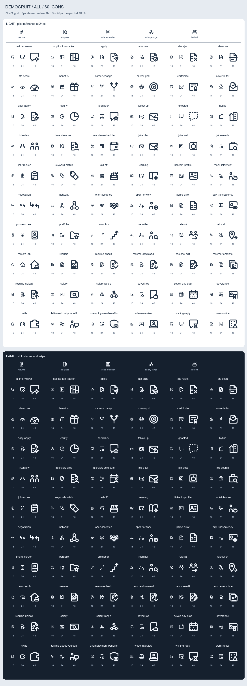

# @democruit-labs/career-icons

**60 original career-themed outline SVG icons** by [Democruit](https://democruit.com), an independent
open-source project of Aequovia, LLC. Resumes, ATS screening, applications, interviews, salary,
career transitions, networking, remote work, career growth and tools.

24×24 grid · 2px stroke · round caps and joins · `currentColor` · no runtime dependencies in the
raw SVG entry · React is an optional peer.



[Design system](docs/design-system.md) · [Category previews and design report](docs/full-set-report.md)

## Install and use

```sh
npm install @democruit-labs/career-icons
```

```jsx
import { ResumeIcon, JobSearchIcon } from "@democruit-labs/career-icons/react";

<ResumeIcon size={24} aria-label="Resume" />;
<JobSearchIcon size={16} aria-hidden="true" />; // next to a visible text label
```

Icons inherit the parent color. The React defaults are `size={24}`, `strokeWidth={2}`,
`color="currentColor"`, `animate="none"`, `animationType="default"`, `animationDuration={560}`,
and `absoluteStrokeWidth={false}`. `CareerIconsProvider`
sets shared defaults; icon props override the provider. `absoluteStrokeWidth` keeps a selected
stroke weight constant in pixels when the icon size changes.

```jsx
import { CareerIconsProvider, AtsPassIcon } from "@democruit-labs/career-icons/react";
import "@democruit-labs/career-icons/animations.css"; // optional; honors reduced motion

<CareerIconsProvider size={24} color="#2563eb" animate="hover" animationDuration={800}>
  <AtsPassIcon aria-label="ATS approved" />
  <AtsPassIcon animationDuration={400} aria-label="Faster ATS approval" />
</CareerIconsProvider>;
```

Pilot motions remain available. Metadata identifies each icon's motion; `animation: "none"`
identifies artwork with no animated parts. Motion is opt-in through the CSS import and `animate`
prop (`hover`, `always`, `none`). A `ci-hover` class lets an ancestor trigger hover motion.
`animationDuration` sets the motion duration in milliseconds for both `default` and `draw`.
It inherits through nested providers; icon props take precedence. With `animate="always"`,
the pause lasts twice the motion duration (800ms motion + 1600ms pause in the example).
Use a non-negative finite number; zero completes immediately and invalid values fall back to
560ms. Raw SVG consumers can set `--ci-animation-duration: 800ms` in CSS.

| Import | Contents |
| --- | --- |
| `@democruit-labs/career-icons` | Named SVG strings, such as `ResumeIcon`, searchable `icons` records, and `version` |
| `@democruit-labs/career-icons/react` | Named React components and provider |
| `@democruit-labs/career-icons/svg/resume.svg` | Optimized standalone SVG |
| `@democruit-labs/career-icons/sprite.svg` | All 60 symbols, identified by kebab-case names |
| `@democruit-labs/career-icons/icons.json` | Titles, categories, search tags, aliases, version and motion metadata |
| `@democruit-labs/career-icons/animations.css` | Optional motion stylesheet |

The installed npm package version is available from the main entry (injected at build time from
`package.json`):

```ts
import { version } from "@democruit-labs/career-icons";
```

## Browse locally

```sh
npm ci
npm run build
npm run site:dev
```

The docs site searches names, titles, tags and aliases, filters by category, and previews every
icon at 16, 24 or 48px on light or dark backgrounds. `npm run site:build` creates the static site
in `site/dist/`; it does not deploy.

## Develop

```sh
npm run validate
npm run lint
npm run typecheck
npm test
npm run build
npm run size
npm run site:build
npm run release:dry-run   # preflight publish (no upload)
npm run release           # publish to npm after CI checks; see AGENTS.md
```

Validation checks the SVG and metadata contract, painted padding and the 1024-byte optimized SVG
limit. Size-limit checks **each of the 60 React imports**, including the shared runtime, under
1KB gzip with React excluded as the peer dependency; animation CSS has a separate 3KB limit.

To reproduce category contact sheets, install Python 3 with Pillow and run
`npm run preview -- resume` (or another category), then `npm run preview -- all` for the full sheet.
Set `PILOT_PYTHON` to your virtual environment's Python if needed. `npm run preview:pilot` preserves
the pilot comparison at strokes 1.5 and 2. Source artwork lives only in `icons/`; review alternatives
under `docs/previews/alternatives/` are excluded from the package.

Read [AGENTS.md](AGENTS.md) before contributing. Draw original geometry; do not copy other icon
sets or include third-party logos. `linkedin-profile` is a generic professional profile card.

## License

[MIT](LICENSE).
